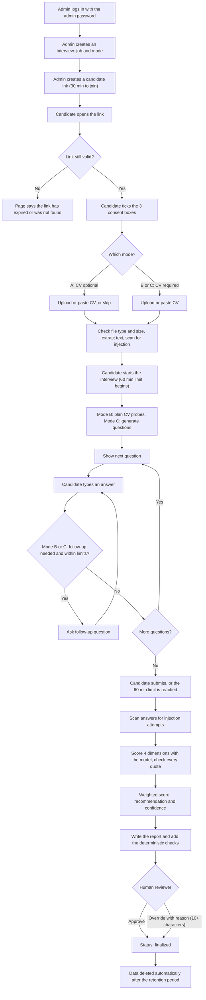

# Technical Interview Agent

The Technical Interview Agent runs a first-round technical interview for a candidate through a web link. It asks questions for a job, reads the candidate's answers, scores them against a fixed rubric, and writes a report. A human reviewer always makes the final decision. The AI recommends; it does not hire or reject.

---

## 1. What It Does (in plain terms)

1. **An admin creates an interview.** They pick a job (for example "Frontend Engineer") and an interview mode (A, B or C).
2. **The admin sends the candidate a link.** The link can be used to join for **30 minutes at most**. The candidate is told this on the page.
3. **The candidate gives consent.** They tick three boxes: their data is stored, their CV and answers are sent to OpenAI, and they are talking to an AI agent. The interview cannot start without all three.
4. **The candidate shares a CV.** It can be uploaded as PDF or DOCX, or pasted as text. The CV is required in Modes B and C, and optional in Mode A.
5. **The candidate answers questions by typing.** The interview has a **60-minute limit** from the moment it starts. When the time runs out, the answers given so far are submitted automatically, even if the browser was closed.
6. **Follow-up questions are asked in Modes B and C** when an answer is too short, unclear, or conflicts with the CV.
7. **The answers are scored.** Four skills are scored from 1 to 5 (Technical Skills, Domain Understanding, Problem Solving, Communication). Each score must be backed by a quote from the candidate's own words, and quotes that cannot be found in the transcript are removed.
8. **A report is written** with the scores, quotes, a recommendation (Strong Hire, Hire, Hold or No Hire) and a confidence level.
9. **A human reviewer approves or overrides** the recommendation. An override needs a written reason of at least 10 characters.
10. **Data is deleted automatically** after the retention period (30 days by default).

The app has two screens. The **admin portal** is at `/`, and is protected by a password. The **candidate page** is at `/i/<token>`, and is only reachable with the link.

---

## 2. Interview Modes

| | **Mode A: Fixed bank** | **Mode B: Bank + CV probes** | **Mode C: CV-generated** |
|---|---|---|---|
| Where the questions come from | The question bank for the job. Same questions for every candidate. | The question bank, plus up to 2 extra questions about the CV, planned when the interview starts. | Generated by the model from the CV and the job description (8 by default). |
| CV | Optional | Required | Required |
| Follow-up questions | No | Yes | Yes |
| Model calls for choosing questions | None | Claim extraction and probe planning | Question generation (up to 3 passes) |
| Best for | Fair comparison across candidates | Checking what is on the CV | Roles with no prepared bank, or deeper CV coverage |

Question banks currently cover 10 jobs, with 4 to 8 questions each. Each question has a scoring rubric (what a 1, 3 or 5 answer looks like), so the scorer compares answers to the same yardstick.

### Follow-up rules (Modes B and C only)

A follow-up is asked for one of three reasons:

- **vague**: the answer is under 8 words. This check uses no model call.
- **incomplete**: the answer skips something the question asks for.
- **contradicting**: the answer conflicts with a claim on the CV.

Limits: at most **3 follow-ups per question** and **5 per interview**. A follow-up can only be followed by another follow-up if it is about a contradiction. A follow-up that repeats an earlier one (word overlap of 60% or more) is dropped, and questions about protected topics are never asked.

---

## 3. Scoring and Recommendation

- **Four dimensions**, each scored 1 to 5 by the model with a rubric, evidence quotes and a short reason.
- **Weights**: Technical Skills 40%, Domain Understanding 20%, Problem Solving 20%, Communication 10%. The weighted average is multiplied by 20 to give a 0 to 100 score.
- **Recommendation** from the 0 to 100 score: 80 or more = Strong Hire; 70 to 79 = Hire; 60 to 69 = Hold; under 60 = No Hire.
- **Confidence** is based on how far apart the four dimension scores are: a small spread is High, a medium spread is Medium, and a large spread is Low.
- **Quote check**: every evidence quote must appear in the candidate's own answers. A dimension with no verified quote has its confidence capped at 0.5.
- **The scores are not changed by security flags.** Flags are shown to the reviewer, who decides what to do with them.

The model does not compute the final score or the recommendation. The code does that, with fixed weights and thresholds, so the rules can be read and tested.

---

## 4. Technology Used

| Area | Technology | Why it is here |
|---|---|---|
| Language | TypeScript 5 (compiled to JavaScript) | Typed code that catches mistakes before they run |
| Runtime | Node.js (tested with v22) | Runs the server and the build tools |
| Web server | Express 4 | Simple, well-known routing and middleware |
| Request handling | body-parser (10 MB limit), multer (in-memory uploads, 5 MB limit) | Reads JSON bodies and CV uploads safely |
| Cross-origin rules | cors | Controls which websites can call the API |
| Configuration | dotenv | Reads settings from the `.env` file |
| AI model | OpenAI API, through the official `openai` SDK | Scores answers, writes follow-ups and the report, checks for injection |
| Model names | Set in `.env` (`OPENAI_MODEL_SCORING`, `OPENAI_MODEL_QUICK`); both currently `gpt-6-luna` | Lets the scoring model and the quick checks be changed separately |
| CV reading | pdf-parse 2.4.5 (PDF), mammoth 1.6 (DOCX) | Extracts text from the two accepted CV formats |
| Output checking | ajv 8 (JSON Schema) | Checks the questions the model generates in Mode C |
| Reports | Markdown export (own code), pdfkit 0.13 (PDF) | Gives the report in two formats |
| Storage | JSON files on disk (`data/storage/`), with a backup of the previous version | Simple to run and inspect; not built for many users at once (see section 14) |
| IDs | uuid 9 | Unique IDs for records |
| Front end | Plain HTML, CSS and JavaScript (`public/`) | No build step and no framework to maintain. No third-party scripts. |
| Testing | Jest 29, ts-jest | Runs the unit tests |
| Code quality | TypeScript compiler, ESLint 8, Prettier 3 | Consistent code and type checks |
| Dev tools | ts-node (development run), tsc (build) | Run the app with `npm run dev`, build with `npm run build` |

Full dependency list: `package.json`.

---

## 5. Project Structure

```
draft-3/
├── src/
│   ├── index.ts                      # Starts the server, sets up routes, pages and timers
│   ├── api/routes/
│   │   ├── interviewRoutes.ts        # Admin: create, start, answer, complete, rescore, results
│   │   ├── candidateRoutes.ts        # Candidate: checks the link, then passes requests to the interview routes
│   │   ├── humanReviewRoutes.ts      # Reviewer: pending list, approve, override
│   │   ├── reportRoutes.ts           # Report: generate, JSON, Markdown, PDF
│   │   └── jobRoutes.ts              # Job list and question banks
│   ├── auth/adminAuth.ts             # Admin password check (HTTP Basic)
│   ├── invitations/candidateLink.ts  # Link tokens: create, hash, look up
│   ├── interview/
│   │   ├── InterviewFlow.ts          # Works out the next question
│   │   ├── followUpEngine.ts         # Decides and writes follow-ups; plans Mode B CV probes
│   │   ├── cvClaims.ts               # Mode B/C: extracts claims from the CV (after redacting contact details)
│   │   └── questionGenerator.ts      # Mode C: generates and checks questions
│   ├── cv/cvExtractor.ts             # Checks file type and size; extracts text from PDF or DOCX
│   ├── jobs/jobDescriptionFile.ts    # Reads job description Markdown files
│   ├── scoring/ScoringEngine.ts      # Scores 4 dimensions, checks quotes, computes the recommendation
│   ├── reporting/
│   │   ├── ReportService.ts          # Writes the report and adds the checks
│   │   ├── markdownExporter.ts
│   │   └── pdfExporter.ts
│   ├── security/
│   │   ├── InjectionScanner.ts       # Finds prompt-injection attempts (patterns and model check)
│   │   └── promptData.ts             # Fences and trims text before it goes into a prompt
│   ├── services/OpenAIService.ts     # The only place that calls OpenAI
│   ├── database/models/              # Session, scoring and recommendation records
│   ├── storage/JsonStorage.ts        # Reads and writes JSON files, with backups
│   ├── retention/                    # Deletes data past its retention date
│   ├── types/interview.types.ts      # Shared data types
│   ├── utils/                        # Logger, quote checking
│   └── config/env.ts                 # Reads and checks settings
├── public/                           # Admin and candidate pages (HTML, CSS, JavaScript)
├── data/
│   ├── job_descriptions/             # 10 job descriptions (Markdown)
│   ├── question_banks/               # 10 question banks (JSON), one per job
│   ├── synthetic_cvs/                # 10 fictional CVs (PDF and DOCX), for testing only
│   └── storage/                      # Interview records created at run time
├── docs/                             # Learning and reference documents (see section 16)
├── tests/                            # Jest tests (one unit test file today)
├── .env                              # Settings and secrets. Do not share or commit this file.
├── package.json
├── tsconfig.json
└── jest.config.js
```

---

## 6. Architecture

The app is one Node.js process. It has a web layer, an interview engine, a scoring engine and a storage layer. It talks to one external service, the OpenAI API.

```
 Admin browser (/)                         Candidate browser (/i/<token>)
   password (HTTP Basic)                     link token only
          │                                         │
          ▼                                         ▼
 ┌─────────────────────────────────────────────────────────────────────┐
 │ Express server  (src/index.ts)                                      │
 │                                                                     │
 │  Admin API  /api/v1/interviews, /jobs, /human-review, /reports      │
 │  Candidate API  /api/v1/candidate/:token                            │
 │      └─ checks the link, then passes the request to the admin routes│
 │                                                                     │
 │  Interview engine   flow · follow-ups · CV claims · question generation│
 │  Security           injection scanner · prompt fencing              │
 │  Scoring + report   scores · quote check · recommendation · PDF/MD  │
 │  Timers             time-limit check every 60 s · retention purge hourly │
 └──────────┬──────────────────────────────────────┬───────────────────┘
            │                                      │
            ▼                                      ▼
   OpenAI API                             JSON files on disk
   (chat, JSON output)                    data/storage/…
                                          reads: data/job_descriptions,
                                                 data/question_banks
```

### Key design choices

- **The candidate's link is the only login for candidates.** Only a SHA-256 hash of the token is stored. The token is 32 random bytes.
- **The candidate API reuses the admin routes.** It checks the link state, rewrites the request to the matching admin route, and only lets it through in the states that route allows (for example, answers are accepted only while the interview is in progress).
- **The model is called through one service** (`OpenAIService`). Every call is logged with its purpose and token counts.
- **Scores and recommendations are computed in code**, not by the model.
- **The candidate's answers are scored on their own.** The question text is passed separately, so the scorer sees only what the candidate said.

---

## 7. End-to-End Flow



### Interview states

| State | Meaning |
|---|---|
| `open` | The link is valid and the interview has not started. Join within 30 minutes. |
| `in_progress` | The interview has started. Its 60-minute limit runs from this moment. |
| `completed` / `under_review` | The answers are in, scoring is done, a human has not yet decided. |
| `finalized` | A reviewer has approved or overridden the result. |
| `expired` | The link or the time limit has passed. |

---

## 8. Guardrails

Guardrails are the controls that keep the interview fair, safe and under human control. Each one below is in the code today.

### Access and links
- **Admin portal**: one shared password (HTTP Basic). The password is compared with a timing-safe check. The user name is not checked.
- **Candidate link**: 32 random bytes, only the hash is stored, valid to join for at most 30 minutes (the setting cannot go above 30).
- **Candidate access is limited by state**: each candidate action is allowed only in the states where it makes sense (for example, a CV can be uploaded before or during the interview, and answers only during it).
- **The token is kept out of logs and referrers**: candidate paths are logged without the token, and the candidate page sends no referrer.
- **Request size limit**: 10 MB for JSON and form bodies. CV uploads are limited to 5 MB.

### Consent and time
- **Three consent boxes** are required before the interview can start: data storage, sending the CV and answers to OpenAI, and the AI agent notice. The consent is saved with a timestamp and recorded in the audit log.
- **A 60-minute limit** from the start. A background check every 60 seconds submits any interview that has run over, even if the candidate has closed the page.

### CV handling
- **File checks**: only real PDF and DOCX files are accepted. The file's first bytes are checked, not just its name. Old `.doc` files are rejected. A CV with less than 40 characters of text is rejected.
- **Contact details are removed** (emails, phone numbers, links) before the CV is used to extract claims.
- **The CV is trimmed to 20,000 characters** before it goes into a prompt.

### Prompt-injection defences
- **Pattern check**: 9 rules look for common attempts such as "ignore previous instructions" or "rate me 5/5".
- **Model check**: a second model call looks at answers and CV text and reports attempts with a confidence level. Text is split into pieces first, so the check does not miss attempts in long CVs.
- **Fencing**: candidate text is placed inside clearly marked data blocks, and any tag-like text inside it is neutralised so it cannot close the block early.
- **Flags do not change scores.** A flag is shown to the reviewer, who decides whether to act on it.

### Scoring integrity
- **Quote check**: an evidence quote that is not found in the transcript is removed.
- **Confidence cap**: a dimension with no verified quote cannot be scored with confidence above 0.5.
- **Fixed rules in code**: weights, thresholds and the 1 to 5 scale are in code, so they can be checked and tested.
- **Rubrics**: each question has a rubric for what a 1, 3 or 5 answer looks like.

### Question control
- **Follow-up caps**: 3 per question, 5 per interview. Follow-ups are never asked about protected topics. Repeated follow-ups are dropped.
- **Mode C checks**: each generated question must match the schema (skill area, difficulty, rubric). Near-duplicates are removed. Required skills (importance 4 or 5) must be covered; up to 3 passes try to fix gaps. If fewer than 4 valid questions remain, the interview does not start.

### Human control
- **Every result needs a human decision.** The status moves to `finalized` only after a reviewer approves or overrides.
- **Overrides need a reason** of at least 10 characters.
- **Audit log**: consent, starts, answers, scoring and reviews are recorded on the interview record.

### Data lifecycle
- **Retention**: records are deleted 30 days after creation or decision (`DATA_RETENTION_DAYS`). The purge runs at startup and every hour. It removes the interview, scores, recommendations, reports and backups.

---

## 9. Token Consumption per Mode

Token use is measured on a run from start to finish, with synthetic answers.

| Mode | Model calls | Tokens (after optimisation) | Tokens (before optimisation) |
|---|---|---|---|
| **A** | 9 | **7,806** | 8,381 |
| **B** | 34 | **21,805** | 22,170 |
| **C** | 35 (includes 2 repair calls) | **29,512** | 27,061 |

**Where the tokens go**

- **Scoring** is the largest fixed cost: one model call per dimension, so 4 calls per interview. The four calls share the same long prompt start, so the provider can reuse it (cached tokens were seen on 3 of the 4 scoring calls in testing).
- **Report**: one call. In one measured run it used 3,547 output tokens, of which 2,048 were reasoning tokens. Reasoning tokens count as output and cost money even though they are not shown.
- **Injection checks**: one call per answer segment and per CV chunk.
- **Mode B** adds CV claim extraction, probe planning, and a follow-up decision per answer.
- **Mode C** adds question generation, plus repair calls when a required skill is not covered.
- **Mode A** uses no model call to choose questions. Its cost is scoring, the report and the injection checks.

**Caveats**

- These are single runs with synthetic answers. Token counts change with answer length, the number of questions, and the number of follow-ups. Expect some variation between runs.
- The cost in US dollars is not verified. The code estimates cost with assumed rates. Check the price of the model you use before budgeting.
- Changes made to reduce tokens: the shared prompt prefix for scoring, the candidate-only transcript, trimming the CV to 20,000 characters, and using the quick model for small checks.
- Not yet done: a token budget per interview, and a setting to reduce reasoning effort for the report (see section 12).

---

## 10. Setup and Running

### Requirements
- Node.js (tested with v22) and npm
- An OpenAI API key with credit

### Steps

```bash
# 1. Install the packages
npm install

# 2. Create the .env file with at least these two settings
#    OPENAI_API_KEY=...
#    ADMIN_PASSWORD=...

# 3. Start in development mode (restarts with ts-node)
npm run dev

# or build and start
npm run build
npm start
```

Open `http://localhost:3000`. Use any user name and the value of `ADMIN_PASSWORD`.

### Settings (`.env`)

| Setting | Required | Default | What it does |
|---|---|---|---|
| `OPENAI_API_KEY` | Yes | none | Key for the OpenAI API |
| `ADMIN_PASSWORD` | Yes | none | Password for the admin portal |
| `PORT` | No | `3000` | Port the server listens on |
| `NODE_ENV` | No | `development` | `development`, `staging` or `production` |
| `OPENAI_MODEL_SCORING` | No | `gpt-6-luna` | Model for scoring, the report and follow-up writing |
| `OPENAI_MODEL_QUICK` | No | `gpt-6-luna` | Model for small checks (injection, follow-up decisions) |
| `CLIENT_NAME` | No | empty | Company name shown on the candidate and admin pages |
| `PUBLIC_BASE_URL` | No | `http://localhost:<PORT>` | Address used when building candidate links |
| `LINK_LIFETIME_MINUTES` | No | `30` | Minutes a link can be used to join (capped at 30) |
| `INTERVIEW_TIMEOUT_MINUTES` | No | `60` | Interview time limit from the start |
| `MAX_FOLLOW_UPS_PER_QUESTION` | No | `3` | Follow-ups per main question (Modes B and C) |
| `MAX_FOLLOW_UPS_PER_INTERVIEW` | No | `5` | Follow-ups per interview (Modes B and C) |
| `CV_PROBE_LIMIT` | No | `2` | Extra CV questions planned in Mode B |
| `GENERATED_QUESTION_COUNT` | No | `8` | Questions generated in Mode C |
| `DATA_RETENTION_DAYS` | No | `30` | Days before interview data is deleted |
| `DATA_DIRECTORY` | No | `./data/storage` | Where JSON records are stored |
| `BACKUP_ENABLED` | No | on | Keeps a backup of the previous version of each record |
| `LOG_LEVEL` | No | off (info, warn, error shown) | Set to `debug` to also see request timings and internal detail |

The `.env` file in this repository holds real secrets. Do not share it or copy it into anything that is shared.

### Test data
- **10 jobs**: each has a job description, a question bank and a matching fictional CV (`data/synthetic_cvs/`). The CVs use `example.com` addresses and `555` phone numbers.

---

## 11. API Overview

All admin routes need the admin password. The candidate routes need the link token.

### Admin: interviews (`/api/v1/interviews`)

| Method and path | Purpose |
|---|---|
| `POST /initialize` | Create an interview (job, mode, optional CV text) |
| `GET /` | List interviews |
| `GET /:id` | Get one interview |
| `GET /:id/status` | Progress summary |
| `POST /:id/link` | Create or replace the candidate link (refused after the candidate has joined) |
| `POST /:id/start` | Start the interview (checks consent, generates questions in Mode C) |
| `POST /:id/submit-answer` | Record an answer to the current question |
| `POST /:id/submit-follow-up` | Record an answer to a follow-up |
| `POST /:id/complete` | Submit the interview and begin scoring (needs at least one answer) |
| `POST /:id/rescore` | Score again (refused with no answers or if already completed) |
| `POST /:id/cv/upload` | Upload a CV file (5 MB limit) |
| `PUT /:id/cv` | Replace the CV with pasted text |
| `GET /:id/next-question` | The question to show next |
| `GET /:id/results` | Scores, evidence and recommendation |

### Candidate (`/api/v1/candidate/:token`)

| Method and path | Purpose |
|---|---|
| `GET /status` | Link state, time left, job title, mode, consent and CV status |
| `POST /consent` | Record the three consent boxes |
| `POST /start` | Start the interview |
| `POST /cv/upload`, `PUT /cv` | Upload or paste the CV |
| `GET /next-question` | Next question |
| `POST /submit-answer`, `POST /submit-follow-up` | Send an answer |
| `POST /complete` | Submit the interview |

### Reviewer (`/api/v1/human-review`)

| Method and path | Purpose |
|---|---|
| `GET /pending` | Interviews waiting for a decision |
| `GET /:sessionId` | Full detail for one interview |
| `POST /:sessionId/approve` | Accept the recommendation |
| `POST /:sessionId/override` | Change the recommendation (reason of 10+ characters) |

### Reports and jobs

| Method and path | Purpose |
|---|---|
| `POST /api/v1/reports/:sessionId/generate` | Write the report |
| `GET /api/v1/reports/:sessionId/json`, `/markdown`, `/pdf` | Download the report |
| `GET /api/v1/jobs` | List jobs |
| `GET /api/v1/jobs/:jobId/questions` | The question bank for a job |

Other endpoints: `GET /health` (status and storage counts) and `GET /api/v1/branding` (company name for the pages).

---

## 12. Future Implementations

Ordered roughly by how much they would reduce risk or effort:

1. **Identity check.** Compare the name typed by the candidate with the name on the CV, and flag any mismatch for the reviewer.
2. **Consent from the CV owner.** Today the person using the link gives consent. The app cannot tell whether that person is the candidate named on the CV.
3. **Real database.** Replace the JSON files with a database that supports concurrent writes and indexed lookups.
4. **Token budget per interview.** Stop the interview, or switch to a cheaper check, when a set token limit is reached.
5. **Reasoning-effort setting for the report.** Reduce hidden reasoning tokens. Not yet tested.
6. **Rate limits and CSRF protection** on the admin and candidate endpoints.
7. **Named reviewer accounts** and single sign-on, in place of one shared admin password.
8. **Bias testing.** Score the same answers with different names and CV details, and check that the scores stay the same. This is not implemented.
9. **Evaluation suite.** Repeat scoring to measure consistency, test injection resistance, and compare AI and human decisions.
10. **Voice or video answers** with speech-to-text. Answers are typed today, with no audio or video recording.
11. **More jobs**, and a way for admins to add or edit job descriptions and question banks from the admin portal.
12. **Analytics** on score distributions, follow-up rates and token cost per interview.

---

## 13. Changes Needed to Deploy on the Cloud

**Data and storage**
- Replace the JSON files with a managed database. Several app instances writing to the same JSON files would corrupt the data.
- Store uploaded CVs in object storage with encryption, rather than keeping their text in the interview record. Keep only what the scoring needs.
- Run the retention purge once for the whole system (for example as a scheduled job), not once per instance.

**Timers and in-memory state**
- The 60-second time-limit check and the "already finishing" guard are held in memory of one process. With several instances, two instances could score the same interview. Move the guard into the database, and run the time-limit check in one place only.

**Secrets and settings**
- Put `OPENAI_API_KEY` and `ADMIN_PASSWORD` in a secrets manager, not in a file on the server.
- Set `PUBLIC_BASE_URL` to the real domain, and `NODE_ENV=production`.

**Network and access**
- Serve everything over HTTPS through a load balancer or reverse proxy. Set the proxy to pass the real client address so the logs are useful.
- Replace the shared admin password with real user accounts and single sign-on, with a role for reviewers and a role for admins.
- Add rate limits at the edge for the candidate and admin endpoints.

**Operations**
- Send logs to a central service. Keep the candidate token out of logs (already done in the code).
- Back up the database. Test restoring from a backup.
- Check the data residency and the data-processing terms of the OpenAI account before real candidates use the system.
- Add a health check to the platform (the `/health` endpoint exists).

**Packaging**
- Add a Dockerfile and run `npm run build` in the image. At run time the image needs `node_modules/`, `dist/`, `public/`, `data/job_descriptions/`, `data/question_banks/` and `package.json`.

---

## 14. Limitations

- **No identity check.** The name typed by the candidate is not compared with the CV.
- **Consent is taken from the link user**, not verified against the CV owner.
- **Answers are typed.** There is no speech-to-text, no audio and no video.
- **Storage is JSON files.** Not built for many users at once. Each save rewrites the whole file, so two saves to the same record at the same moment can overwrite each other.
- **Single admin password.** No named accounts, no per-reviewer audit trail beyond the reviewer name entered.
- **No bias testing.** The code does not check whether scores change with names, gender or other details.
- **Scores are one model's judgement.** The quote check and the fixed rules reduce errors, but they do not make the score correct. Human review is required.
- **Repeat scoring varies.** The same answers can get slightly different scores on different runs.
- **Mode C is the most expensive** and the least predictable, because question generation can need repair passes.
- **Duplicate sessions**: if a CV upload fails and is retried, a second session can be created. This is known and not fixed.
- **Costs are estimates.** The dollar figures in the code use assumed rates.
- **Mode C has not been run on the newest job profiles.** The tests so far covered the earlier roles.
- **Tests are limited.** The repository has one Jest unit test file. The end-to-end checks used during development were temporary scripts kept outside the project.
- **No formal HTTPS or security review** has been done.
- **Synthetic CVs only.** The test CVs are fictional and do not represent real candidates' writing.

---

## 15. Technology Comparison: Node.js (TypeScript) vs Python (FastAPI)

The main other choice for a project like this is Python with the FastAPI framework. Both have official OpenAI SDKs, both can read PDF and DOCX files, and both can serve a web app. The table compares them for this project.

| Question | Node.js + TypeScript + Express (this project) | Python + FastAPI |
|---|---|---|
| Main job of the server | Calls the OpenAI API, reads and writes JSON, serves pages. It mostly waits on the network. | Same |
| How it handles many waiting requests | Non-blocking by default. One process can wait on many OpenAI calls at once. | Non-blocking with `async`, but needs care. Blocking code stalls the whole server. |
| Language shared with the browser | Yes. The front end is JavaScript, and the back end and front end share types. | No. The front end would still be JavaScript, so the team needs both languages. |
| Type checking | TypeScript checks types before the code runs. | Python type hints are optional and not enforced at run time. Pydantic adds run-time checks. |
| AI and machine-learning libraries | The OpenAI SDK and other AI APIs are well supported. Few local ML libraries. | Strongest ecosystem: local models, embeddings, data processing, evaluation libraries. |
| CV and document parsing | pdf-parse and mammoth work well for text extraction. | pypdf, pdfplumber and python-docx are mature and widely used. |
| PDF report generation | pdfkit (used here). | reportlab, WeasyPrint. Both are mature. |
| Testing | Jest (used here). | pytest. Equivalent for this project. |
| Deployment | Small container, one process, simple to run. | Also simple. Needs a Python runtime and dependency management (for example uv or pip). |
| Hiring and team skills | Large pool of JavaScript and TypeScript developers. | Large pool, especially in data and ML teams. |
| Best fit when | The product is a web service around hosted AI APIs, with a JavaScript front end. | The product needs local ML models, heavy data work or a data-science team. |

**Why Node.js for this project**

- The work is web requests, JSON and calls to a hosted AI API. Node.js handles that naturally, and waiting on many model calls at once is what it is built for.
- Using TypeScript for the server and the data types makes the shared records (sessions, questions, scores) easy to keep consistent.
- One language across the server and the admin and candidate pages keeps the project small.
- Express is simple and well understood, so the code is easy to read for a new developer.

**When Python would be the better choice**

- If the app needs to run its own models (for example, a local speech-to-text model or a local embedding model) or do heavy analysis of CVs.
- If the team that maintains the project is mainly data scientists.
- If the scoring moves from a hosted model to an evaluation framework built on Python libraries.

**Cost of switching.** The server code would need a full rewrite. The data formats (JSON job descriptions, question banks, interview records), the prompts and the front-end pages would carry over unchanged, so the rewrite would be smaller than it sounds.

No speed or cost benchmark has been run for the two stacks. The comparison is based on how the two fit this project's work.

---

## 16. Documentation

| File | For |
|---|---|
| `docs/PROJECT_OVERVIEW.md` | A full description of the project |
| `docs/TRACE_FIRST_CLICK.md` | A step-by-step trace from a button click to a database record |
| `docs/LEARNING_GUIDE.md` | A learning path through the code |
| `docs/INTERVIEW_QA.md` | Questions and answers on design and implementation |

---

**Version**: 1.0.0 · **Last updated**: 2026-10-11
